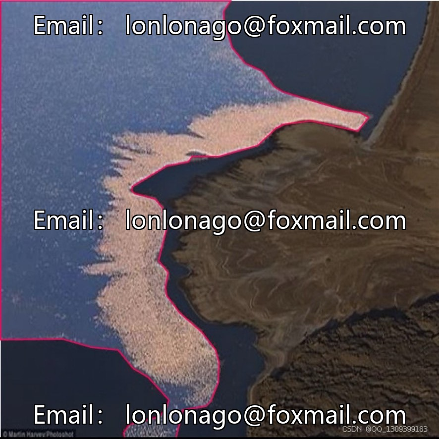
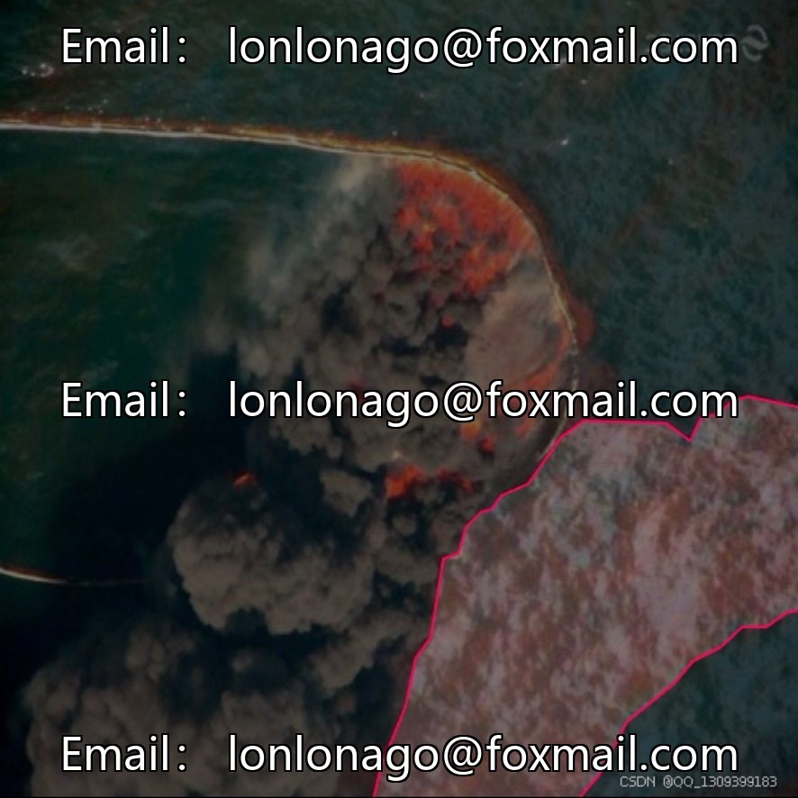
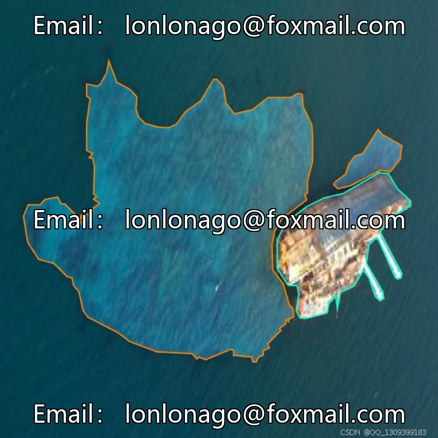
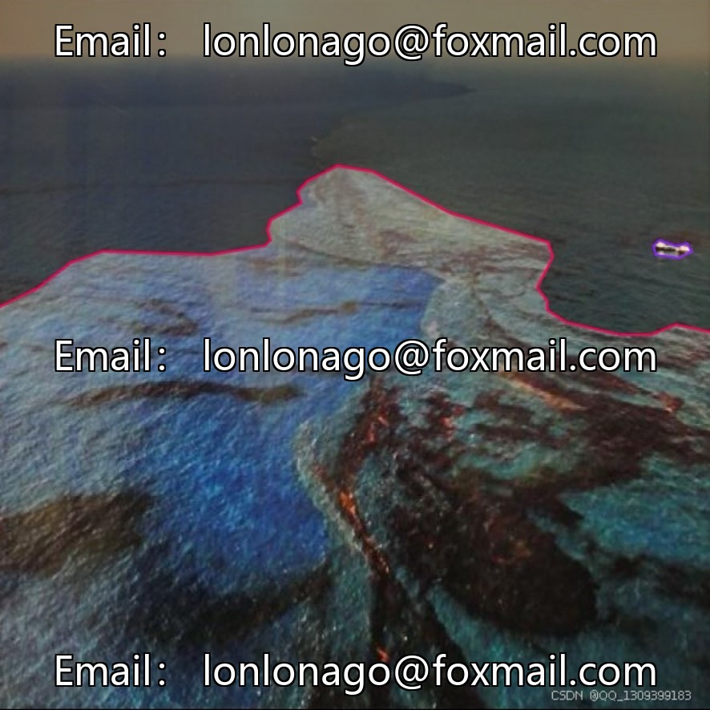

# Drone aerial photography of oil spills on the sea surface and ship detection dataset | Issue 10103

## Body

Drone aerial photography of oil spills on the sea surface and ship detection dataset | Issue 10103

The dataset consists of 1,043 labeled images, with five categories: crude oil, emulsion, oil film, oil platform, and ship. It supports instance segmentation tasks, with labeled formats including contours of the target and category labels. It is accompanied by one instance segmentation model suitable for scenarios such as marine environmental monitoring, maritime emergency response, and algorithm development.

The data scale is moderate, and the accompanying models can be directly tested or optimized for secondary use, suitable for rapid startup of small to medium-sized projects.

Virtual materials, once sold, are non-refundable.
Interested friends, click "I want" to proceed.

## Images

## Payment

Here is a pay link on Stripe ( https://buy.stripe.com/3cs8yP7sY87d0vu9AB ). Please contact me lonlonago@foxmail.com after funding $89, and I will send you a complete data files , thank you!

